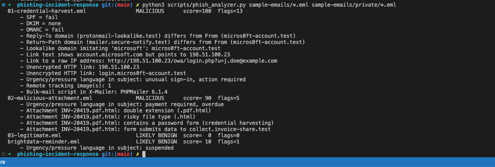
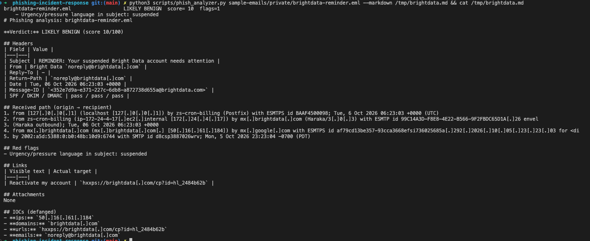
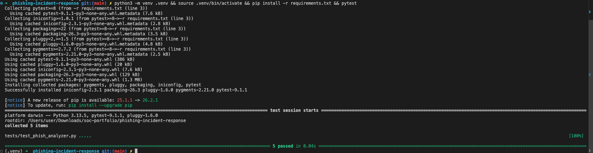

# Phishing Incident Response

Analysing phishing emails end to end: header forensics, link and attachment analysis, IOC extraction, and response, with a Python tool that automates the triage.

## Objective
- Tell phishing from legitimate email using evidence, not gut feel.
- Automate the repetitive parts of triage (header parsing, URL extraction, hashing, defanging).
- Produce IOC lists and incident reports a SOC can act on.

## Tools
Python 3 (standard library only), Thunderbird / a text editor for raw `.eml`, VirusTotal, URLScan.io, AbuseIPDB, MXToolbox header analyser.

## The analyzer

```bash
python scripts/phish_analyzer.py sample-emails/*.eml
```

```
01-credential-harvest.eml                MALICIOUS      score=100  flags=13
    - SPF = fail
    - DMARC = fail
    - Reply-To domain (protonmail-lookalike.test) differs from From (micros0ft-account.test)
    - Lookalike domain imitating 'microsoft': micros0ft-account.test
    - Link text shows account.microsoft.com but points to 198.51.100.23
    ...
02-malicious-attachment.eml              MALICIOUS      score= 90  flags=5
    - Attachment INV-20419.pdf.html: double extension (.pdf.html)
    - Attachment INV-20419.pdf.html: contains a password form (credential harvesting)
    - Attachment INV-20419.pdf.html: form submits data to collect.invoice-share.test
03-legitimate.eml                        LIKELY BENIGN  score=  0  flags=0
```

What it checks:

| Check | Why it matters |
|---|---|
| SPF / DKIM / DMARC results | Spoofed or unauthenticated senders |
| From vs Reply-To vs Return-Path | Replies diverted to the attacker |
| Received chain, origin IP | The real source of the email |
| Display name vs domain, lookalikes (`micros0ft`) | Brand impersonation |
| Link text vs actual href, raw-IP links, HTTP | Deceptive links |
| Attachment hashes, double extensions, risky types, embedded password forms, URLs and form targets inside HTML attachments | Malware / HTML smuggling |
| Urgency language, tracking pixels, PHPMailer | Social engineering and kit fingerprints |

Export a report:
```bash
python scripts/phish_analyzer.py email.eml --json ioc-reports/x.json --markdown analysis/x.md
```

It **never** fetches URLs or opens attachments, so it's safe to run on live samples.

Run the tests: `pip install -r requirements.txt && pytest`

## Investigations
| ID | Sample | Verdict | Report |
|---|---|---|---|
| INC-001 | Microsoft credential harvest | Malicious | [analysis/INC-001-credential-harvest.md](analysis/INC-001-credential-harvest.md) |
| INC-002 | Invoice lure with HTML attachment | Malicious | [analysis/INC-002-invoice-html-attachment.md](analysis/INC-002-invoice-html-attachment.md) |

Response process: [analysis/PLAYBOOK.md](analysis/PLAYBOOK.md)

## Results

| Sample | Manual verdict | Tool verdict | Score | Red flags | Match |
|---|---|---|---|---|---|
| 01 Credential harvest | Malicious | MALICIOUS | 100 | 13 | ✅ |
| 02 HTML attachment | Malicious | MALICIOUS | 90 | 5 | ✅ |
| 03 Legitimate IT notice | Benign | LIKELY BENIGN | 0 | 0 | ✅ |
| **Real email:** Bright Data "suspended account" reminder | Benign | LIKELY BENIGN | 10 | 1 | ✅ |

**Real-world test.** A genuine "your account is suspended" email from a SaaS provider (Bright Data) looks like a classic phishing lure on the surface. The tool rated it LIKELY BENIGN (10/100), and manual analysis agreed:
- SPF, DKIM and DMARC all pass and align with `brightdata.com`, which publishes a strict `p=REJECT` DMARC policy.
- The external sending hop is `mx.brightdata.com` (50.16.61.184). The internal hops (127.0.0.1, 172.24.4.17) were correctly excluded from the IOCs.
- The single link's visible text matches its real destination (`https://brightdata.com/...`).
- The only red flag was "suspended" in the subject. Urgency alone isn't enough to call an email phishing.

The email itself isn't committed (it's in the git-ignored `sample-emails/private/`) because it contains personal data.

**Gap found and fixed.** In INC-002, the most important indicator, the domain that receives the stolen passwords, sits inside the HTML attachment's `<form action>`. The first version only scanned the email body, so it missed it. The analyzer now pulls URLs and form targets out of HTML attachments (reading them as text, never rendering them), and a test covers it. Score for that email: 70 → 90.

**Key takeaway.** Sample 02 *passes* SPF, DKIM and DMARC and is still malicious. Authentication tells you which domain sent the mail, not whether the domain can be trusted. That's why the tool weighs content and attachments as well as headers.

Tests: 5 passing (`pytest`). Lint: clean.

### Screenshots
**Verdicts for all samples, including the real email:**



**Full report for the real Bright Data email:**



**Test suite:**



**Next:** run it on a real *phishing* email from your spam/junk folder (save as `.eml` into `sample-emails/private/`, which is git-ignored), compare with VirusTotal/URLScan lookups, and add the outcomes here without any personal data.

## Limitations
- The score is a heuristic with hand-picked weights. It's tuned on the samples here, not a large corpus, so expect false positives and negatives.
- It reads the `Authentication-Results` header the receiving server wrote. It doesn't re-verify DKIM signatures itself.
- No reputation lookups (VirusTotal etc.); that's done in the [SOC Automation](https://github.com/Jampal24/soc-automation-python) project.
- No OCR, so image-only phishing and QR-code phishing ("quishing") aren't analysed.
- HTML attachments are scanned as text. Heavily obfuscated JavaScript (e.g. HTML smuggling that builds the URL at runtime) won't reveal its URLs without a sandbox.
- Sample emails are synthetic and use reserved domains and documentation IPs.

## Layout
```
sample-emails/  synthetic .eml samples (real ones go in sample-emails/private/, git-ignored)
analysis/       incident reports + auto-generated analyses + playbook
ioc-reports/    machine-readable IOC JSON
scripts/        phish_analyzer.py
tests/          pytest tests
screenshots/    lab evidence
```
